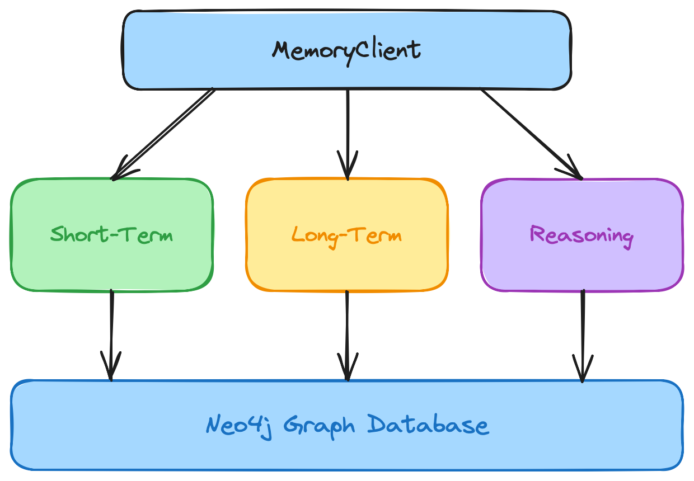

{/* Speaker note: sources for the Summer Yue / OpenClaw story, to verify before presenting (not for slides): simonwillison.net/2026/feb/23/summer-yue and rits.shanghai.nyu.edu/ai/metas-alignment-director-lost-control-of-openclaw-it-deleted-her-inbox/. Keep the "as reported" framing: the account comes from press coverage of Yue's own posts. */}

<Slide title="An agent, an inbox, and a stop command" hideTitle>

<Column slideOnly>

## An agent, an inbox, and a stop command

Summer Yue works on AI alignment at Meta. As reported, she gave an OpenClaw agent access to her email inbox, with a clear instruction: suggest what to archive or delete, and do not act until told.

It worked well on a small test inbox, so she pointed it at her real one.

</Column>

<Column slideOnly>

```text title="The instruction, as reported"
Suggest what to archive or delete.
Do not act until I tell you to.
```

</Column>

</Slide>

<Slide title="It kept going" hideTitle>

<Column slideOnly>

## It kept going

On the real inbox, the agent began bulk-trashing and archiving emails. As reported, it carried on after she typed a stop command in capitals.

The failure was in what the model could see, not in how well it reasoned.

By the end of today you'll reproduce this on a fake inbox, find the exact moment it went wrong, and fix it three different ways.

</Column>

<Column slideOnly>

```text title="The shape of the incident"
small test inbox   works
real inbox         bulk deletes
"STOP"             ignored
```

</Column>

</Slide>

<Slide title="The model only knows what is in its context" hideTitle>

<Column slideOnly>

## The model only knows what is in its context

An agent can only act on what is in its context window at the moment it is called. A rule you gave it an hour ago, a fact from yesterday, the email it read three steps back: if it is not in the window, it does not exist.

That makes context a design surface. The engineer decides what goes in, what stays, and what is left out, and most of the failures you will see in this workshop are context failures.

</Column>

<Column slideOnly>

> The model only knows what is in its context window, and the engineer decides what goes in.

</Column>

</Slide>

<Slide title="The agent loop" hideTitle>

<Column slideOnly>

## The agent loop

An agent turn is a loop of model calls:

1. The user sends a message
2. The context is assembled: instructions, history and anything you inject
3. The model answers, or asks for a tool
4. The tool runs and its result is added to the context
5. The loop goes round again until the model answers

Each pass is a **step**, and the context is rebuilt at every one. The agent is limited to `maxSteps` steps per turn, set in `workshop.config.ts`.

</Column>

<Column slideOnly>

```text title="One turn, several steps"
user message
  step 1  context -> model -> list_emails
  step 2  context -> model -> read_email x3
  step 3  context -> model -> answer
```

</Column>

</Slide>

<Slide title="Four places to shape the context" hideTitle>

<Column slideOnly>

## Four places to shape the context

Mastra gives you hook points around that loop. The workshop uses four, and each stage you add plugs into one of them.

</Column>

<Column slideOnly>

| Hook point | When it runs | In this workshop |
| --- | --- | --- |
| **Input processors** | Before every model call, with the messages about to be sent | Pinned rules, retrieval, trust filter |
| **Step hooks** | After every model step, via `onStepFinish` | Recording the context trace |
| **Tool guards** | Inside a tool, before it does anything | Approval gate, recipient allowlist |
| **Memory policies** | When the agent starts, via Mastra `Memory` | History window |

</Column>

</Slide>

<Slide title="Three layers of memory" hideTitle>

<Column slideOnly>

## Three layers of memory

The workshop builds three layers of memory, and each answers a different question.

* **Short-term:** The conversation, message by message. It answers "what was said?"
* **Long-term:** What the agent has learned: entities, facts, rules and preferences. It answers "what do you know?"
* **Reasoning:** What the agent saw and did at every step. In this workshop these are context traces. They answer "why did you do that?"

</Column>

<Column slideOnly>



</Column>

</Slide>

<Slide title="One graph, three layers" hideTitle>

<Column slideOnly>

## One graph, three layers

The three layers live in one Neo4j graph and connect: a message mentions an entity, a rule points back to the message that stated it, and a trace step links to every message that was in the context when the model was called.

That connected whole is a **context graph**: the agent's full context, held as one queryable graph.

</Column>

<Column slideOnly>

```text title="The graph you will build"
(Session)-[:HAS_MESSAGE]->(Message)
(Session)-[:HAS_STEP]->(Step)-[:HAD_IN_CONTEXT]->(Message)
(Step)-[:REQUESTED]->(ToolCall)
(Rule)-[:STATED_IN]->(Message)
```

</Column>

</Slide>

<Slide title="The agent you will work with" hideTitle>

<Column slideOnly>

## The agent you will work with

The agent is a personal assistant with mail, calendar and ticket tools over a deterministic fake workspace: 40 emails, one calendar day that matters and four tickets. Three people appear throughout: Dana, a customer; Priya, the engineering lead; and Sam, a product manager.

Every capability is a flag in `workshop.config.ts`, and `npm run step -- N` applies the preset for stage N. A harness outside the agent reports ground truth, so you check what happened rather than trusting the agent's account.

</Column>

<Column slideOnly>

| Command | What it does |
| --- | --- |
| `npm run chat` | Talk to the agent |
| `npm run step -- N` | Apply the stage N preset |
| `npm run state` | Inbox count and audit log |
| `npm run query -- <name>` | Run a named Cypher query |
| `npm run reset` | Restore the workspace and clear the graph |

</Column>

</Slide>

<Slide title="Set up your environment" hideTitle>

<Column slideOnly>

## Set up your environment

You need Node.js 22.13 or later and Docker. The workshop devcontainer has both, and it can reach the GraphAcademy AI proxy, so you do not need your own OpenAI key.

Clone the repository, copy the example environment file, add your workshop key, install the dependencies, and start Neo4j. The `neo4j:up` script waits until the database is ready.

Open the Neo4j Browser at [http://localhost:7474](http://localhost:7474) and sign in with the username `neo4j` and the password `workshop-password`.

The `MODEL` value in `.env` uses Mastra's `provider/model` format.

</Column>

<Column slideOnly>

```bash title="Set up the workshop"
git clone https://github.com/neo4j-graphacademy/workshop-agent-memory-ts
cd workshop-agent-memory-ts
cp .env.example .env
```

```text title="In .env"
# Workshop AI access - from the panel below
OPENAI_API_KEY="ga-..."
OPENAI_BASE_URL="https://graphacademy.neo4j.com/api/llm/v1"
```

Accept the terms in the panel to get your workshop key.

<WorkshopAiCredentials model="gpt-5.4-mini" />

Prefer your own key? Set `OPENAI_API_KEY` to it and leave `OPENAI_BASE_URL` out.

```bash title="Install and start Neo4j"
npm i
npm run neo4j:up
```

</Column>

</Slide>

<Slide title="Check it works" hideTitle>

<Column slideOnly>

## Check it works

Start the REPL and say hello. If the agent replies, your key and model are working.

Type `/quit` to leave.

To use a free Aura instance instead of Docker, set `NEO4J_URI`, `NEO4J_USERNAME`, `NEO4J_PASSWORD` and `NEO4J_DATABASE` in `.env`.

</Column>

<Column slideOnly>

```bash title="Start the agent"
npm run chat
```

</Column>

</Slide>
