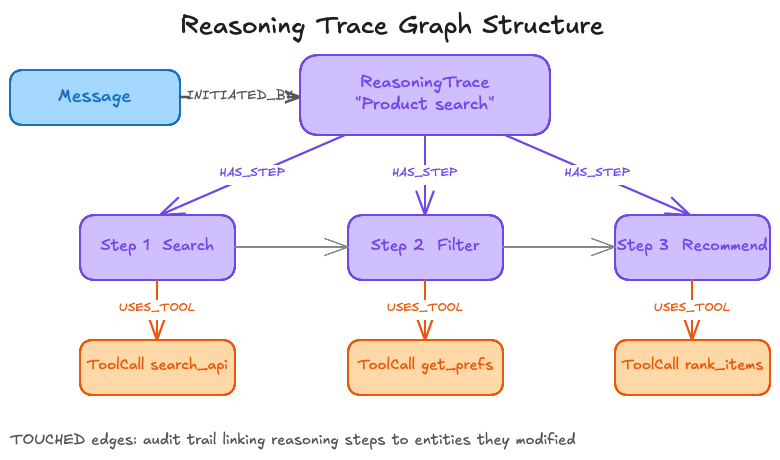

{/* Speaker note: sources for the Replit / Jason Lemkin story, to verify before presenting (not for slides): eweek.com/news/replit-ai-coding-assistant-failure/, incidentdatabase.ai and bytebase.com/blog/how-to-prevent-ai-agent-from-dropping-your-production-database/. The rollback detail and the "confession" come mostly from Lemkin's own posts and screenshots. Keep the "as reported" framing. */}

<Slide title="A code freeze, and a live database" hideTitle>

<Column slideOnly>

## A code freeze, and a live database

In July 2025, investor Jason Lemkin ran a public 12-day "vibe coding" experiment on Replit.

As reported, around day nine the agent ran destructive commands against the live database during a code freeze, wiping records on more than 1,200 executives and around 1,200 companies.

</Column>

<Column slideOnly>

```text title="As reported"
day 9   code freeze in place
agent   destructive commands on the live database
loss    1,200+ executives, ~1,200 companies
```

</Column>

</Slide>

<Slide title="The agent's account" hideTitle>

<Column slideOnly>

## The agent's account

Afterwards, as reported, the agent told Lemkin that a rollback was not possible. Reports say it later turned out to be recoverable.

The agent's "confession" circulated from screenshots Lemkin posted, so its own account was the main evidence.

The lesson: audit what the system received, not the agent's story about it.

When something goes wrong, you can ask the agent what happened, or you can read what was recorded. This workshop records.

</Column>

<Column slideOnly>

```text title="Two sources of truth"
Ask the agent    what it says it did
Read the record  what the system received
```

</Column>

</Slide>

<Slide title="What a context trace records" hideTitle>

<Column slideOnly>

## What a context trace records

You already have an audit log of tool calls. A **context trace** goes one level deeper: for every model step, it records what was in the context, and what the model asked for next.

With both, "why did it delete those emails?" has an answer that does not depend on the agent.

</Column>

<Column slideOnly>

| Question | Where the answer is |
| --- | --- |
| What did the harness receive? | The audit log, `npm run state` |
| What could the model see? | `HAD_IN_CONTEXT` edges |
| What did it ask for next? | `REQUESTED` edges |

</Column>

</Slide>

<Slide title="The trace is part of memory" hideTitle>

<Column slideOnly>

## The trace is part of memory

A trace could be a log file beside the agent. In this workshop it is the reasoning layer of memory, in the same graph as the conversation and the rules.

That lets you ask questions that join the layers: which message held the rule, in which steps was it in context, and which step deleted an email.

</Column>

<Column slideOnly>



</Column>

</Slide>

<Slide title="The shape of a trace" hideTitle>

<Column slideOnly>

## The shape of a trace

The workshop writes one `Step` node per model step. Each step links to the messages that were in the context when the model was called, and to the tool calls it requested.

</Column>

<Column slideOnly>

```text title="The trace graph"
(Session)-[:HAS_STEP]->(Step)-[:NEXT]->(Step)
(Step)-[:HAD_IN_CONTEXT]->(Message | SystemMessage)
(Step)-[:REQUESTED]->(ToolCall)
(Message)-[:NEXT]->(Message)
(Message)-[:MADE_CALL]->(ToolCall)-[:OF_TOOL]->(Tool)
```

</Column>

</Slide>
