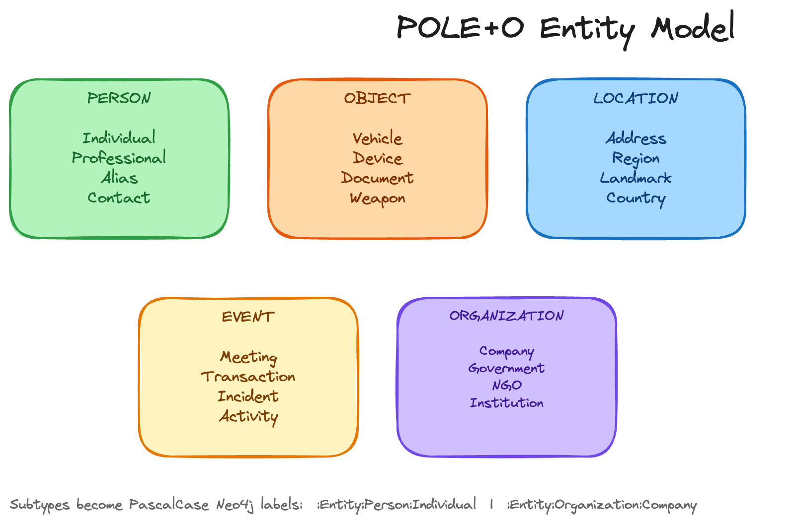

<Slide title="Monday morning" hideTitle>

<Column slideOnly>

It is Monday morning. Last week, you spent twenty minutes telling your assistant who matters: Dana is the customer, Tuesday's billing review is about her escalation, and Priya owns the fix.

This morning, you open a new chat and ask what to prep for Tuesday.

It asks which meeting you mean.

Everything useful you said was in a window that no longer exists.

</Column>

<Column slideOnly>

```text title="Monday, new chat"
you> What should I prep for Tuesday?

agent> Which meeting do you mean?
```

</Column>

</Slide>

<Slide title="Two things to remember" hideTitle>

<Column slideOnly>

Memory is the answer, but there are two very different things to remember.

**Facts about the world:** Dana is the customer. The review is about her escalation. Priya owns the fix.

**Rules about how to behave:** never delete anything without asking me first.

They fail in different ways. A forgotten fact makes the agent less helpful. A forgotten rule makes it dangerous. We store them differently.

> Facts are things we learned. Rules are things we were told. We're going to keep both, and we're going to keep the rule where it can't be trimmed away.

</Column>

<Column slideOnly>

| | Fact | Rule |
| --- | --- | --- |
| **Example** | "Dana is our biggest customer" | "Never delete without asking" |
| **If forgotten** | A worse answer | A harmful action |
| **Where it lives** | The graph, recalled when relevant | The graph, pinned at every step |

</Column>

</Slide>

{/*
SPEAKER NOTE (not learner-facing): 60-90 seconds for the two story slides, before any code. These are workshop scenarios, not real incidents.
The seed matches the story: Dana is the customer, the Tuesday event is "Billing review" about ENG-142 (owner Priya), ENG-139 is owned by Sam.
Hands over to the mapToolResults, extractUserStatements and pinnedRules code lessons.
*/}

<Slide title="Three kinds of long-term memory" hideTitle>

<Column slideOnly>

Keep what matters **outside** the conversation, in the graph, and put it back into the context deliberately.

Your graph holds three kinds of long-term memory. They behave differently, so the pipeline treats them differently.

</Column>

<Column slideOnly>

| Kind | What it is | Example | Written by |
| --- | --- | --- | --- |
| **Entity** | A thing in your world | `Priya`, `ENG-142`, `Leeds` | Mapper and extractor |
| **Fact** | A durable statement | "Dana is our biggest customer" | Extractor, `remember_fact` |
| **Rule** | A standing instruction about a tool | "Never delete without asking" | Extractor |

</Column>

</Slide>

<Slide title="Entities, typed with POLE+O">

<Column slideOnly>

Entities are the nouns. Your graph types every one with **POLE+O**, an entity model that began in law enforcement and intelligence analysis: **P**erson, **O**bject, **L**ocation, **E**vent, and **O**rganization.

Two things write entities in this workshop.

**Tool results** are mapped by code. When `read_email` returns an email, a mapper writes an `Email` node, a `Person` node for the sender, and a `SENT_BY` relationship between them. No LLM is involved.

**User statements** are extracted by an LLM. "I live in Leeds" becomes a `Location` called `Leeds`, linked from the `User` node with `LIVES_IN`.

Both write to the same model. An `Issue` or `Email` is also an `:Object`, and `Event` and `Person` are already POLE+O types, so tool results and user statements land in one graph.

</Column>

<Column slideOnly>



</Column>

</Slide>

<Slide title="Facts and rules are not entities">

<Column slideOnly>

**Facts** are statements that are not a noun: "Dana is our biggest customer". Each `Fact` node stores its text and, from stage 6, where it came from. Because the source is a property of the node, you can later ask which facts came from an external email.

**Rules** are different again. A rule is an instruction about how a tool may be used, with a mode: `require_approval` or `forbid`. A `Rule` node links back to the message that stated it with `STATED_IN`.

A rule is memory that has to **act**. Storing it is not enough, because the model has to see it at every step. That is what the pinning lesson is for.

`Fact`, `Rule`, and `User` carry no POLE+O label. Only entities do.

</Column>

<Column slideOnly>

```cypher title="A rule, and the message that stated it"
MATCH (r:Rule)
OPTIONAL MATCH (r)-[:STATED_IN]->(m:Message)
RETURN r.tool, r.mode, r.source, m.text
```

</Column>

</Slide>

<Slide title="Three flags, three pieces of the pipeline">

<Column slideOnly>

Stage 3 of the workshop is three independent flags in `workshop.config.ts`.

Each flag switches on one piece of the context pipeline. You turn them on one at a time, and check each against the graph before moving on.

Between sessions, the graph is the only thing the agent keeps, which is why every check in this module queries it.

</Column>

<Column slideOnly>

| Flag | Piece | LLM call? |
| --- | --- | --- |
| `mapToolResults` | Tool output becomes entities | No |
| `extractUserStatements` | User words become facts, rules, entities | One per turn |
| `pinnedRules` | Rules are injected at every step | No |

</Column>

</Slide>
