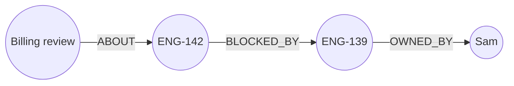

<Slide title="The person nobody mentioned" hideTitle>

<Column slideOnly>

You ask your assistant: "Who should I chase before Tuesday's billing review?"

A flat search finds everything that sounds like that question: the agenda, Dana's complaint, a ticket titled "Billing export fails".

It misses Sam.

Sam owns the migration that blocks the ticket. His emails never mention billing, exports, or reviews. Nothing in the text links Sam to the meeting.

</Column>

<Column slideOnly>

```text title="What similarity returns"
event  ev-002  Billing review, Tuesday 14:00
email  e-021   Finance Ops: Expense ...
email  e-014   Invoices table migration: plan
...
```

```text title="What it misses"
Sam
```

</Column>

</Slide>

<Slide title="Only the relationships know" hideTitle>

<Column slideOnly>

Only the relationships link Sam to the meeting.

The meeting is about a ticket. The ticket is blocked by another ticket. Sam owns that one.

Mastra's own write-up on memory layers acknowledges the general limit: semantic recall can pull back something related that is not useful.

> Similarity finds what sounds like your question. Relationships find what's connected to it.

</Column>

<Column slideOnly>



</Column>

</Slide>

{/*
SPEAKER NOTE (not learner-facing): 60-90 seconds for the story slides, before any code. These are workshop scenarios, not real incidents.
Source for the semantic-recall limitation: https://mastra.ai/blog/agent-memory-layers (Mastra's write-up on memory layers).
The seed matches the story: Billing review (Tuesday) is ABOUT ENG-142 (owner Priya), which is BLOCKED_BY ENG-139 (owner Sam, ETA Thursday).
Hands over to the semantic baseline, then the graph version, then the side-by-side.
*/}

<Slide title="Load the same data twice">

<Column slideOnly>

Both retrieval systems need the same data for a fair comparison.

`npm run ingest` loads every email, event, and ticket into the graph with the same deterministic mappers you used in the last module. No LLM is involved. The semantic index is built from the same seed on first use.

If you completed module 4 with `mapToolResults` on, some of this is already in your graph. `ingest` is safe to rerun: the mappers use `MERGE`.

</Column>

<Column slideOnly>

```bash title="Start from stage 3 and ingest"
npm run step -- 3
npm run ingest
```

```text title="Expected"
ingested 45 tool outputs into the graph
```

</Column>

</Slide>

<Slide title="The path, by hand">

<Column slideOnly>

Before you automate it, walk the path in Neo4j Browser.

One row comes back: the event, the ticket it is about, the ticket that blocks it, and the person who owns the blocker. The ETA is Thursday, after Tuesday's meeting.

</Column>

<Column slideOnly>

```bash title="The named query"
npm run query -- eventToBlockerOwner
```

```cypher title="The same query in Neo4j Browser"
MATCH (e:Event)-[:ABOUT]->(i:Issue)-[:BLOCKED_BY]->(b:Issue)-[:OWNED_BY]->(o:Person)
WHERE toLower(e.title) CONTAINS 'billing review'
RETURN e.title, i.id, b.id, b.title, b.eta, o.name
```

</Column>

</Slide>
