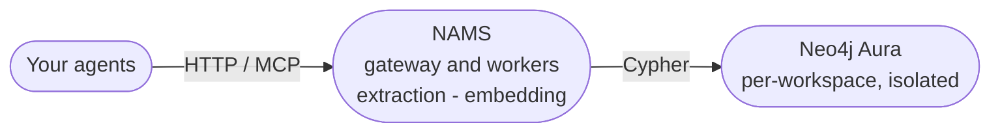
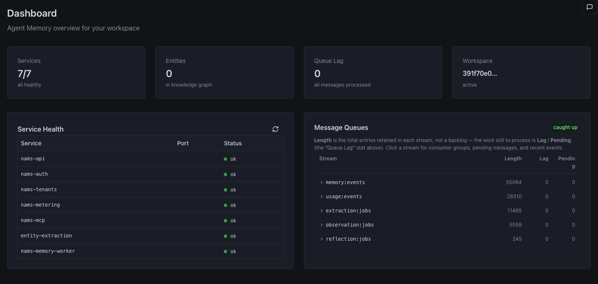

<Slide title="Show and tell" hideTitle>

<Column slideOnly>

Show what you built. Two minutes each, and answer one question: *what does your agent remember, and why?*

Say which path you took, run the check you used, and show the row in `npm run state` or the graph that proves it.

</Column>

<Column slideOnly>

| Say | Show |
| --- | --- |
| Which path | The file you changed |
| What it remembers or blocks | A query result or an audit entry |
| Why it matters | The failure it prevents |

</Column>

</Slide>

<Slide title="Memory as a managed service">

<Column slideOnly>

Everything you built by hand, including storage, extraction, embedding, and deduplication, also exists as a managed service: **NAMS**, the Neo4j Agent Memory Service.

You call a REST API or connect an MCP client, and NAMS runs the database, the pipelines, and the upkeep.

NAMS is a Neo4j Labs project, so expect it to change. Explore it at [memory.neo4jlabs.com](https://memory.neo4jlabs.com), and read the documentation at [neo4j.com/labs/agent-memory](https://neo4j.com/labs/agent-memory/).

The ideas in this workshop carry over: what goes in the context, what the model is allowed to do, and where each fact came from.

</Column>

<Column slideOnly>

</Column>

</Slide>

<Slide title="The NAMS console">

<Column slideOnly>

Each workspace comes with a console: a dashboard over the service's health and queues, a memory browser over the knowledge graph, a review queue for entity resolution, and a read-only Cypher query console.

A good stretch task for after the workshop is to compare what you built by hand with what the managed service does for the same agent.

</Column>

<Column slideOnly>

</Column>

</Slide>

<Slide title="Keep learning">

<Column slideOnly>

* **Go deeper on context graphs:** [Context Graphs: Agent Memory with Neo4j](/courses/genai-context-graphs)
* **Expose tools to any agent:** [Building GraphRAG TypeScript MCP tools](/courses/genai-mcp-build-custom-tools-typescript)
* **Use memory in your own agent:** [NAMS](https://memory.neo4jlabs.com)
* **More workshops:** the [workshops page](/workshops)

</Column>

<Column slideOnly>

Write up what you pointed the agent at, what you taught it to remember, and what came of it. Send it to your instructor, and it can be featured on the GraphAcademy blog.

</Column>

</Slide>
